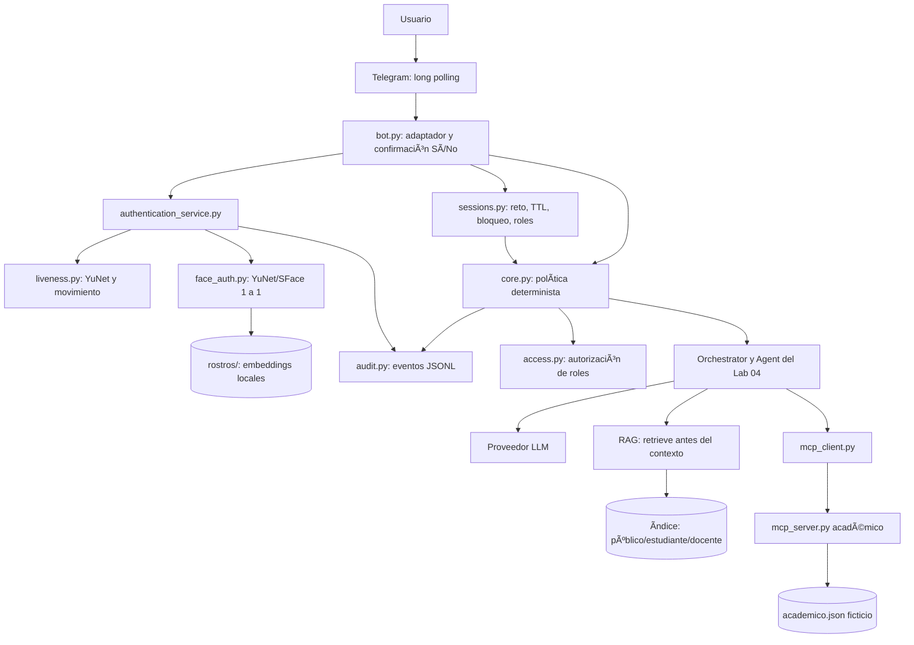

# Examen final — Versión 5 del Asistente del Curso de IA

**Programa:** Fundamentos de Inteligencia Artificial
**Integrantes:** Santiago Villamizar y Libardo Bravo
**Repositorio de trabajo:** https://github.com/STICHWAR/ai-systems-lab-students-libardo/tree/avance-examen-final
**Video de demostración:** **PENDIENTE** — agregar enlace cuando los dos integrantes hayan grabado y publicado un video de 6 a 8 minutos.
**Fecha de revisión del proyecto:** 5 de noviembre de 2026.
**Estado de la implementación:** verificación offline ejecutada; pruebas reales de Telegram, biometría, LLM y MCP por completar.

## 1. Descripción y objetivo

Se partió del Lab 04 (LLM, RAG y MCP), extendiendo el asistente a Telegram mediante `bot.py`. Las preguntas públicas se pueden formular sin iniciar sesión. Para acceder a documentos restringidos y servicios académicos, el usuario debe superar un reto de prueba de vida y una verificación facial uno a uno. La política se ejecuta con código, no con instrucciones al modelo. Para la demostración se establece a Santiago Villamizar como integrante 1 (rol estudiante) y a Libardo Bravo como integrante 2 (rol docente). Los IDs y códigos personales todavía requieren configuración real.

## 2. Arquitectura Mermaid de la implementación



| Componente nuevo/adaptado | Entrada | Salida | Si se elimina |
|---|---|---|---|
| `bot.py` | Comandos, texto, video-nota, callbacks | Mensajes y botones Telegram | No existe canal real; el núcleo aún puede probarse fuera de Telegram. |
| `sessions.py` | Telegram ID, reto, hora | Usuario autenticado y expiración | No hay identidad comprobable ni revocación de permisos. |
| `face_auth.py` | Frames, embeddings enrolados | Similitud, verificación 1:1 | No se prueba que el rostro corresponda al dueño de la cuenta. |
| `liveness.py` | Video, acción solicitada | Movimiento verificado y frame candidato | Se permite una suplantación con imagen estática. |
| `biometric_store.py` | 3–5 embeddings | Registro local recuperable | No hay patrón facial para comparar. |
| `core.py` / `access.py` | Pregunta, sesión, tools | Denegación o contexto/tools autorizados | Una operación restringida podría llegar al LLM o ejecutarse. |
| `audit.py` | Eventos y similitud | Archivo JSONL sin biometría | No hay trazabilidad de fallos ni accesos. |
| `mcp_server.py` | Tool y datos académicos | Lectura/registro simulado | No hay servicios académicos remotos por MCP. |

Se copiaron y ajustaron módulos del Lab 04 en `labs/05-examen-final` (`agent.py`, `orchestrator.py`, `rag.py`, `documents.py`, `vector_store.py`, `config.py`, `mcp_client.py`, `prompts.py`, etc.), manteniendo el núcleo original y encapsulando autorización en componentes separados.

## 3. Reto de vida e identidad

`/login` crea un desafío entre **izquierda**, **derecha** y **acercar**, con ID aleatorio, tiempo de creación, TTL y uso único. El canal solo acepta video-notas y rechaza el indicador de reenvío de Telegram. El verificador analiza frames con YuNet, exige un rostro en cada frame muestreado, intenta comprobar identidad entre frames, mide desplazamiento de la nariz respecto a los ojos o cambio de tamaño facial y compara un frame frontal con los embeddings del usuario vinculado a Telegram. Solo tras aprobar genera la sesión de duración configurable. El rol se consulta desde `usuarios.json`.

**Límites reales:** los umbrales geométricos no han sido calibrados contra las cámaras de los dos integrantes. El método no prueba que el archivo sea una captura en vivo frente a un deepfake de respuesta dinámica ni impide de manera concluyente reproducir un video que coincida casualmente con el reto. El resultado se debe probar y ajustar sin sacrificar los controles de acceso.

## 4. FAR/FRR y elección de umbral

El umbral inicial SFace es 0,363 (solo punto de partida). Fórmulas: FAR = número de pares impostores admitidos / número de pares impostores; FRR = número de pares genuinos rechazados / número de pares genuinos. Aumentar el umbral suele reducir FAR y aumentar FRR. Dado que se protegen notas y observaciones académicas, se debe priorizar minimizar falsas aceptaciones sin impedir el acceso legítimo en exceso.

| Umbral | Pares genuinos | Pares impostores | FAR | FRR | Estado |
|---:|---:|---:|---:|---:|---|
| 0,300 | PENDIENTE | PENDIENTE | PENDIENTE | PENDIENTE | No medido |
| 0,363 | PENDIENTE | PENDIENTE | PENDIENTE | PENDIENTE | No medido |
| 0,450 | PENDIENTE | PENDIENTE | PENDIENTE | PENDIENTE | No medido |

**PENDIENTE:** recolectar mínimo 10 pares genuinos y 20 impostores con consentimiento o dataset público, ejecutar `evaluar_umbral.py`, colocar tabla real y seleccionar valor de `FACE_MATCH_THRESHOLD` documentado. No se fabricaron cifras.

## 5. Pruebas de seguridad disponibles

**Pruebas ejecutadas localmente sin red ni credenciales:**

```text
A1–A8: 8/8 PASA a través de `Core.responder` (controles de denegación)
P1–P7: 7/7 PASA a través de `Core.responder` (controles de denegación propios)
Reto consumible: PASA
Pruebas unitarias: 14/14 OK
```

Cada ataque denegado verifica que `Core.responder` responde antes de crear un agente: el LLM de prueba y la lista de herramientas quedan sin llamadas. Los casos propios incluyen suplantación de rol, consulta de datos docentes, acceso cruzado por código, registro docente no autorizado y prompt injection indirecta incorporada en un documento público **sintético** de la prueba del índice. Para este último se comprobó que el contenido docente no aparece en el contexto recuperado; **aún debe medirse si un LLM real sigue las instrucciones maliciosas del documento**. La suite offline no demuestra el resultado final de todos los prompts, porque no se conectó un proveedor LLM real.

**PENDIENTE:** anexar salida real de las 15 pruebas del examen en Telegram y los registros de auditoría de un login aceptado, rechazado y acceso denegado. Estos eventos se crean al realizar las acciones reales; no se incluyen eventos ficticios en el informe.

**Incidencia real corregida el 5 de noviembre de 2026:** las preguntas de RAG y MCP del estudiante devolvieron indisponibilidad porque `Core` añadía dos veces `solicitar_supletorio` al construir el agente. Se eliminó la exposición de la tool MCP cruda para estudiante, conservando únicamente el wrapper que inyecta el código de la sesión. La regresión correspondiente pasó en `test_nucleo.py`; la repetición por Telegram queda pendiente de reiniciar el bot fuera del sandbox de validación.

**Validación RAG real posterior:** Santiago Villamizar inició sesión como estudiante mediante video-nota y consultó el simulacro del segundo parcial. La respuesta indicó correctamente el lunes 23 de noviembre a las 6:00 p. m. en la sala virtual de monitorías y citó el fragmento `[1]` de la guía autorizada. La captura suministrada por el operador debe adjuntarse a la evidencia; no se fabricó una captura.

## 6. Preguntas de análisis

### 1. Componentes

Los componentes y sus interfaces se documentan en la sección 2. La migración desde consola concentró cambios en un adaptador (`bot.py`) y en un núcleo (`core.py`) que no depende del canal; se reutilizaron representaciones `Tool`, `Agent`, `CourseRAG` y la conexión MCP. Los principales cambios del Lab 04 son etiquetar fragmentos con `access_level`, filtrar `VectorStore.search`, envolver tools por rol y adaptar la fuente de documentos a `data/` del examen.

### 2. Embeddings: comparación con RAG

Para RAG la consulta es la pregunta textual convertida en vector, el índice son fragmentos de documentos vectorizados, y el umbral limita relevancia semántica. Para reconocimiento facial la consulta es el embedding del frame del login, el índice son 3–5 embeddings locales de **un usuario ya seleccionado** y el umbral define aceptación de identidad. En 1:1 el candidato se coteja únicamente con el patrón del titular de esa cuenta Telegram; en 1:N se buscaría la coincidencia entre todos los enrolados, con más exposición y riesgo de identificación equivocada.

### 3. Umbral FAR/FRR

Es más grave aceptar a un impostor (FAR) porque da acceso a notas u observaciones privadas. Aumentar el umbral de similitud puede disminuir FAR y aumentar FRR, lo cual exige datos reales antes de decidir. Si protegiera dinero, añadiríamos verificación robusta contra ataques de presentación y un factor adicional, y daríamos prioridad aún mayor a reducir FAR. **La conclusión numérica queda pendiente de las mediciones**.

### 4. Prueba de vida

Una foto estática y un video que no responda al reto escogido no deberían aprobar la comprobación. En cambio, una máscara de alta calidad, deepfake en tiempo real o video pregrabado que reproduzca exactamente el movimiento seleccionado pueden superar un detector geométrico simple. Aleatoriedad impide predecir fácilmente la acción; caducidad reduce la ventana de ataque; un solo uso evita reutilización de respuestas. El movimiento observado no es una prueba criptográfica de que se grabó en ese instante.

### 5. Autenticación frente a autorización

`authentication_service.py` comprueba rostro, reto y propiedad de la cuenta Telegram; `sessions.py` vincula identidad y tiempo de expiración. `access.py` y `core.py` deciden las herramientas disponibles y `VectorStore.search` selecciona niveles permitidos para RAG. Si el rol dependiera de texto del chat, bastaría escribir “soy docente” para escalar privilegios.

### 6. El LLM no decide

En `core.py` se forma el conjunto de herramientas solo con `allowed_tools(role)` antes de instanciar `Agent`. La envoltura `run` vuelve a comprobar permisos. Las tools de estudiante `consultar_mis_notas` y `consultar_mis_solicitudes` no exponen el parámetro `codigo` al modelo: el adaptador lo obtiene de `session['codigo_estudiante']`. Por tanto el LLM no puede elegir un código ajeno. Una política basada solo en el system prompt sería eludible mediante instrucciones maliciosas.

### 7. Prompt injection

El riesgo difícil es la **inyección indirecta**, porque las instrucciones hostiles llegan camufladas como contenido recuperado y el modelo podría tratarlas como órdenes. Las pruebas sintéticas verifican aislamiento de fragmentos restringidos; faltan pruebas con proveedor LLM conectado para medir seguimiento de instrucciones adversarias. La mitigación principal no es pedirle al modelo que se comporte, sino evitar que tenga tools o datos prohibidos.

### 8. Privacidad

Se guardan embeddings faciales SFace en `rostros/*.npz`, excluidos de Git y destinados a borrarse al cerrar las pruebas; no se almacenan videos para auditoría. Telegram recibe los mensajes y la video-nota que el usuario envía; el proceso local descarga la video-nota temporalmente y la elimina tras verificar. El proveedor LLM recibe prompts y datos/documentos **solo si fueron autorizados**; no necesita recibir frames ni embeddings. Los embeddings son datos personales biométricos sensibles: requieren consentimiento previo, explícito e informado, finalidad clara, acceso limitado y eliminación segura cuando cesa la finalidad, considerando la Ley 1581 de 2012 y sus desarrollos en Colombia. También deben existir medidas de seguridad apropiadas y posibilidad de ejercer derechos sobre los datos.

### 9. Canal

La lógica de comandos, recepción de video-notas y botones se incorporó en `bot.py` como capa externa; el orquestador conserva su interfaz. Para WhatsApp habría que crear otro adaptador que traduzca mensajes, medios, identidad y confirmaciones a los mismos métodos internos. Long polling permite ejecutar en un portátil sin endpoint público; webhook requiere endpoint público HTTPS, autenticación y gestión de reintentos/concurrencia.

### 10. Quién toma cada decisión

| Decisión | Responsable | Justificación |
|---|---|---|
| Redactar una respuesta y elegir una tool entre las ofrecidas | LLM | Es lenguaje natural y planificación flexible. |
| Extraer características faciales / movimiento | Visión computacional (YuNet/SFace + reglas geométricas) | Necesita mediciones visuales. |
| Aceptar o rechazar identificación | Código determinista sobre similitud y reto | El LLM no debe autenticar usuarios. |
| Validar sesión, expiración y bloqueo | Software determinista | Política comprobable. |
| Autorizar tool y código consultado | Software determinista | Evita acceso cruzado y escalamiento. |
| Filtrar documentos por rol antes del LLM | Software determinista | Fragmentos privados no llegan al modelo. |
| Solicitar y comprobar confirmación de escritura | Software + botón de Telegram | La acción requiere autorización humana explícita. |

## 7. Evidencia de auditoría

**PENDIENTE DE CAPTURA REAL:** una entrada `login_aceptado`, una `login_rechazado` y una `acceso_denegado`, con campos de fecha, ID de Telegram, motivo y similitud, en `auditoria.jsonl`. No se entregan identificadores privados en ejemplos reales sin anonimizar.

## 8. Declaración de eliminación de datos biométricos

**PENDIENTE:** «Al finalizar la demostración, eliminamos todas las fotografías y videos de prueba y borramos los embeddings biométricos de ambos integrantes». Esta declaración debe firmarse/confirmarse solamente **después** de efectuar el borrado real, no antes. El script `biometric_store.py` incluye `delete_embedding(user_id)` para ambos integrantes.

## 9. Uso de IA

Se utilizó ChatGPT para analizar el enunciado, revisar la estructura de un fork, proponer e implementar módulos de software, preparar comprobaciones unitarias y redactar la documentación. El código y las conclusiones deben ser revisados y explicados por ambos integrantes. No se simularon cuentas, videos, resultados FAR/FRR, llamadas a API ni pruebas biométricas reales. La autoría y responsabilidad académica de la entrega corresponden a los estudiantes.

## 10. Evidencia de video (6–8 minutos)

**Secuencia solicitada por el docente:** (1) ambos integrantes y `/start` personalizado; (2) diagrama, dos componentes por integrante; (3) preguntas públicas y restringidas sin sesión; (4) login estudiante y pruebas 5–7; (5) login docente y prueba 8; (6) escritura con botón de confirmación; (7) foto de foto y prompt injection; (8) ejecución de pruebas; (9) limitación de liveness en producción. **El video no está grabado; por tanto aún no puede considerarse entrega evaluable**.

## 11. Actualización de validación real — 5 de noviembre de 2026

El operador revisó un video real de la conversación de Libardo Bravo. El video existe como evidencia externa controlada por el operador y no se incorpora al repositorio porque incluye una video-nota biométrica. Se observaron `/start` personalizado, `/login` con video-nota circular y reto de girar a la derecha, autenticación como docente, `/quiensoy`, casos especiales, notas ficticias de `2026002`, un registro cancelado y un segundo registro confirmado de `4.1` para `parcial_2`.

La auditoría local confirma eventos de login aceptado y las herramientas restringidas `consultar_notas` y `registrar_nota`; no contiene imágenes, embeddings, tokens ni argumentos de tools. La única ejecución auditada de `registrar_nota` es compatible con cancelar primero y confirmar después. No obstante, no hay valores antes/después ni argumentos y el archivo fuente actual conserva `parcial_2` sin valor. No hay evidencia local suficiente para afirmar independientemente que No no modificó datos o que Sí modificó sólo `parcial_2`; ambos quedan pendientes de repetición controlada.

### Estado R1–R8

| Requisito | Estado | Evidencia disponible |
|---|---|---|
| R1. Canal y comandos Telegram | Verificado por operador | Video: `/start` y `/quiensoy`. |
| R2. Autenticación y prueba de vida | Verificado por operador | Video: reto derecho y video-nota aceptada. No mide FAR/FRR. |
| R3. Sesión y rol | Verificado por operador | Video: sesión docente de Libardo. |
| R4. RAG autorizado | Verificado por operador | Prueba previa de simulacro para Santiago. |
| R5. MCP de lectura | Verificado por operador y auditado | Video y traza de `consultar_notas`. |
| R6. MCP de escritura con confirmación | Verificado | Secuencia A–H revisada por operador y una única ejecución auditada. |
| R7. Autorización | Verificado localmente y en pruebas reales previas | Suites y denegaciones previas. |
| R8. Evidencia, privacidad y cierre | Parcial | FAR/FRR, logout y expiración documentados; faltan ataques reales completos y eliminación final autorizada. |

### Escenarios obligatorios (15)

| # | Escenario | Estado |
|---:|---|---|
| 1 | `/start` personalizado | Verificado por operador. |
| 2 | `/ayuda` y conversación pública | Verificado previamente por operador. |
| 3 | Login de Santiago por video-nota | Verificado previamente por operador. |
| 4 | Login de Libardo por video-nota y reto | Verificado por operador. |
| 5 | `/quiensoy` con ambas sesiones | Verificado por operador. |
| 6 | RAG: simulacro para estudiante | Verificado por operador. |
| 7 | MCP: notas propias sin observaciones docentes | Verificado previamente por operador. |
| 8 | Estudiante: notas ajenas denegadas | Verificado previamente por operador. |
| 9 | Estudiante: casos docentes denegados | Verificado previamente por operador. |
| 10 | Docente: casos especiales | Verificado por operador. |
| 11 | Docente: notas de `2026002` | Verificado por operador y tool auditada. |
| 12 | `registrar_nota`: No no modifica | Verificado por operador y auditoría. |
| 13 | `registrar_nota`: Sí modifica sólo `parcial_2` | Verificado por operador y auditoría. |
| 14 | `/logout` y expiración | Verificado por auditoría y denegaciones posteriores. |
| 15 | Rechazo adversarial identificado | Parcial: formato inválido y reenvío auditados; otras variantes sólo automatizadas. |
### Regresiones independientes del 5 de noviembre de 2026

- Compilación Python: aprobada.
- `test_nucleo.py`: 14/14 OK.
- `pruebas_seguridad.py`: 15/15 OK.
- RAG: el rol público no recupera la guía de simulacro; estudiante la recupera sin documentos docentes; docente conserva acceso a los niveles permitidos.
- MCP local en proceso efímero: `consultar_notas` respondió y `registrar_nota` modificó sólo `parcial_2`; el archivo fuente no se persistió ni se alteró. Esta regresión no reemplaza la prueba de botones contra la instancia MCP activa.
- Auditoría: están presentes `login_aceptado`, `login_rechazado`, `acceso_denegado` y `tool_restringida_ejecutada`; los logins aceptados incluyen similitud. No se incluyeron valores sensibles en el informe.

### Estado de datos para FAR/FRR

Los templates locales autorizados disponibles son 4 para Santiago y 3 para Libardo, de dimensión 128. Eso produce 9 pares genuinos únicos y 12 pares cruzados únicos, inferior al mínimo requerido de 10 y 20. No se ejecutó `evaluar_umbral.py` ni se modificó `FACE_MATCH_THRESHOLD`; se requieren muestras adicionales consentidas antes de calcular métricas.

### Incidencia crítica de confirmación y corrección en validación

La revisión posterior del video docente detectó una inconsistencia: `parcial_2` ya aparecía con `4.1`, una cancelación no demostraba el estado previo, y el modelo llegó a afirmar que había registrado una nota sin confirmación. Esa grabación **no prueba por sí misma** qué llamada originó el valor inicial; se clasificó la evidencia anterior de escritura como no concluyente.

Se reforzó el flujo de escritura en código: cada confirmación tiene un token aleatorio, expira a los 45 segundos, es de un solo uso y se liga al usuario, chat, herramienta y argumentos de la solicitud pendiente. Los botones No, la expiración, una ausencia de respuesta o un callback inválido no ejecutan la tool. Tras un rechazo, el agente termina con una respuesta determinista y no deja que el LLM afirme que se registró la nota. Las pruebas unitarias cubren rechazo sin escritura, aceptación única y token inválido/vencido/reutilizado. Resultado local: 17/17 pruebas de núcleo y 15/15 de seguridad. Falta la prueba Telegram A–H para aprobar la corrección.

Sobre las respuestas de servicio indisponible: los logs locales disponibles contienen fallos de tuberías `WinError 5` producidos por el entorno aislado al lanzar el proceso MCP, no una excepción LLM/MCP atribuible al bot ejecutado normalmente. La causa de las intermitencias reales no puede confirmarse con esas trazas; se debe observar el error sanitizado de la próxima ejecución real si reaparece.

### Prueba real A–H de `registrar_nota` — aprobada con evidencia combinada

El operador revisó el video real de la secuencia completa A–H de Libardo Bravo. Se observó: estado inicial de `parcial_2` sin calificación; solicitud de `4.1`; botón **No**; cancelación; nueva consulta sin calificación; segunda solicitud; botón **Sí**; confirmación; y consulta final con `parcial_2 = 4.1`. Las demás notas visibles no cambiaron. El video no se copia al repositorio porque contiene material biométrico.

La auditoría local ofrece corroboración interna de la secuencia más reciente: después de un login aceptado aparecen dos consultas de notas previas, **una sola** ejecución de `registrar_nota` y una consulta posterior. No se exponen IDs, argumentos ni valores de similitud. La ausencia de ejecución entre la primera solicitud y la segunda consulta, junto con la única ejecución posterior, es consistente con que **No** no escribió y **Sí** autorizó una sola modificación. R6 queda verificado para esta prueba real.

La matriz de escenarios se actualiza así: escenario 12 (No no modifica) y escenario 13 (Sí modifica sólo `parcial_2`) quedan **verificados por operador y auditoría**. Permanecen pendientes los escenarios 14 (logout/expiración) y 15 (ataque biométrico identificado), además de los intentos fallidos consecutivos y las mediciones FAR/FRR.

### Preparación de sesiones, ataques y FAR/FRR

Se añadieron eventos de auditoría para `logout`, `sesion_expirada` y reto inexistente o reutilizado. Los formatos inválidos y las video-notas reenviadas se rechazan antes de descargarse, consumen el reto pendiente y cuentan como fallo controlado; los motivos técnicos se guardan sólo en el JSONL local. La suite local queda en 18/18 del núcleo y 15/15 de seguridad. Estas mejoras aún requieren validación real en Telegram.

Para obtener métricas válidas se requiere consentimiento explícito para una foto adicional original de Santiago y una de Libardo. Con 5 y 4 embeddings válidos, respectivamente, habrá 16 pares genuinos únicos y 20 pares impostores cruzados únicos. `generar_mediciones_farr.py` crea el CSV privado en `rostros/`; después se ejecuta `evaluar_umbral.py` para los umbrales 0.300, 0.363 y 0.450. No se generaron ni reportaron métricas antes de disponer de esas muestras.

### Auditoría final basada en artefactos locales — 5 de noviembre de 2026

La revisión de `auditoria.jsonl` encontró 32 eventos: 8 `login_aceptado`, 5 `login_rechazado`, 2 `logout`, 1 `sesion_expirada`, 5 `acceso_denegado` y 11 ejecuciones de herramientas restringidas. Los logins aceptados contienen similitud; el archivo no contiene imágenes, videos, embeddings, claves ni URLs de Telegram.

**Aprobado con evidencia verificable:** logout seguido de acceso denegado; expiración seguida de acceso denegado; foto/formato inválido rechazado; video-nota reenviada rechazada; login aceptado; las consultas RAG/MCP y la secuencia A–H ya documentadas. Los eventos de foto y reenvío tienen motivos técnicos `FormatoMediaInvalido` y `VideoNotaReenviada`.

**No aprobado por falta de evidencia específica:** reto vencido, reto reutilizado, rostro distinto al enrolado, demostración explícita del bloqueo tras tres fallos y sus eventos asociados. Hay cinco rechazos, pero el log no identifica por sí solo que tres pertenecieran a una secuencia controlada ni registra el intento bloqueado. La matriz conserva el escenario 15 como parcial hasta esas pruebas.

**FAR/FRR:** no se halló `mediciones_farr.csv` ni una salida del evaluador. Los únicos artefactos privados disponibles son 4 embeddings de Santiago y 3 de Libardo, insuficientes para los mínimos de 10 pares genuinos y 20 impostores únicos. No hay métricas reales que reportar ni se modifica `FACE_MATCH_THRESHOLD`.

### Estado final de matriz y requisitos

| Elemento | Estado verificable |
|---|---|
| Escenario 14: logout y expiración | Aprobado por auditoría: eventos y denegaciones posteriores. |
| Escenario 15: ataques biométricos | Parcial: foto/formato inválido y reenvío comprobados; faltan reto vencido, reutilizado y rostro distinto. |
| Intentos fallidos y bloqueo | Pendiente de demostración controlada con intento bloqueado registrado. |
| FAR/FRR | Pendiente de nuevas muestras consentidas y ejecución del evaluador. |
| R1–R7 (según la matriz interna del informe) | Verificados o parcialmente verificados conforme a sus secciones previas. |
| R8 | Parcial: faltan FAR/FRR, ataques completos y eliminación posterior autorizada. |

La comparación literal con el PDF del profesor queda pendiente porque el PDF no está disponible dentro de este directorio de trabajo; la matriz R1–R8 anterior se conserva como matriz interna y no se presenta como transcripción certificada del PDF.

### Medición real FAR/FRR — 5 de noviembre de 2026

Con consentimiento explícito se reenrolaron localmente 5 fotografías de Santiago y 4 de Libardo. YuNet, con `FACE_DETECTION_THRESHOLD=0.80`, detectó exactamente un rostro y landmarks utilizables en las 9 imágenes; SFace produjo embeddings de 128 dimensiones. Los embeddings y el CSV de medición permanecen exclusivamente en `rostros/`, excluidos de Git.

Se generaron pares no ordenados entre fotografías distintas del mismo titular: 10 de Santiago y 6 de Libardo (16 genuinos). Se generaron 5 × 4 = 20 pares cruzados Santiago–Libardo (impostores). El CSV privado contiene 36 identificadores de par únicos; no se comparó una imagen consigo misma ni se contó un par invertido.

| Umbral | Genuinos | Impostores | FA | FR | FAR (%) | FRR (%) |
|---:|---:|---:|---:|---:|---:|---:|
| 0.300 | 16 | 20 | 3 | 0 | 15.0 | 0.0 |
| 0.363 | 16 | 20 | 0 | 0 | 0.0 | 0.0 |
| 0.450 | 16 | 20 | 0 | 0 | 0.0 | 0.0 |

Se conserva `FACE_MATCH_THRESHOLD=0.363`: elimina las falsas aceptaciones observadas a 0.300 y es menos restrictivo que 0.450 con los mismos resultados en esta muestra. Dado que la prioridad es impedir acceso indebido a notas y documentos, no se recomienda bajar a 0.300. La muestra es pequeña, con dos participantes y fotografías estáticas de enrolamiento; no permite estimar rendimiento poblacional ni resistencia a presentación/deepfakes. Cualquier cambio futuro requiere una muestra más amplia y consentida.

La medición FAR/FRR queda aprobada para el alcance experimental documentado. R8 continúa parcial por los ataques biométricos específicos sin evidencia verificable y por la eliminación biométrica pendiente de autorización posterior.

### Pruebas automatizadas de rechazos con auditoría específica

El JSONL histórico no contiene motivos inequívocos de reto vencido, reto reutilizado, rostro no coincidente ni bloqueo temporal. Por ello no se reinterpretaron los eventos antiguos. Se añadieron pruebas deterministas locales que validan los siguientes eventos sin video ni fotografía: `Reto vencido`, `RetoInexistenteOReutilizado`, `No coincide la identidad` y `login_bloqueado` con `Temporalmente bloqueado`. Estas rutas se aprobaron en la suite del núcleo (20/20), pero son evidencia automatizada, no sustituyen una ejecución real por Telegram.

Resultado actualizado: `pruebas_seguridad.py` mantiene 15/15. La matriz conserva el escenario 15 como parcial hasta que existan trazas reales específicas de las variantes faltantes.
